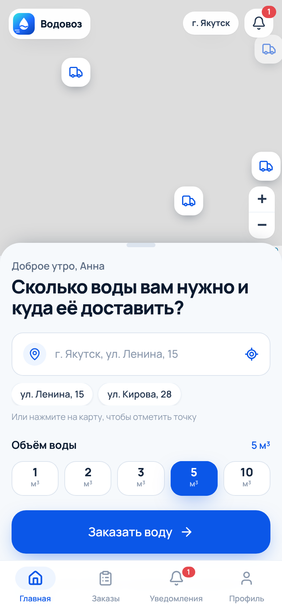
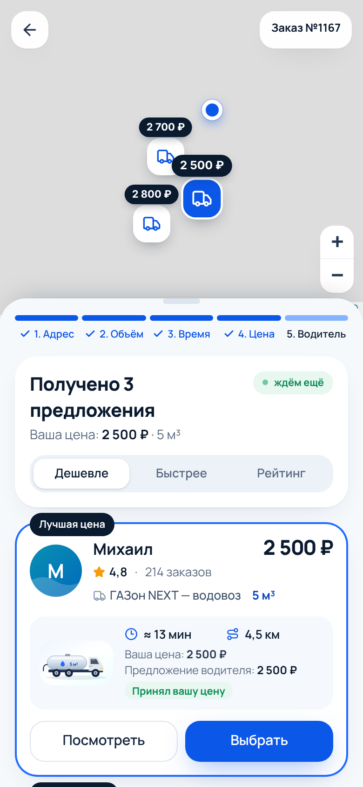
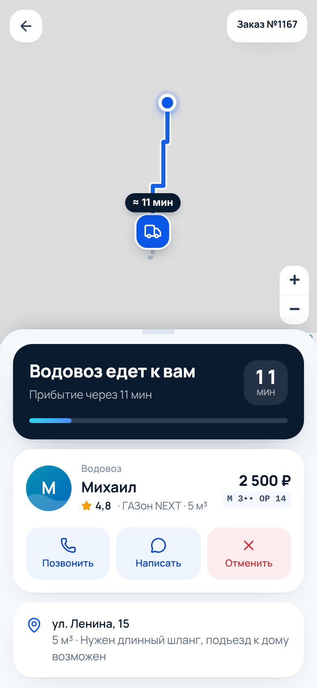
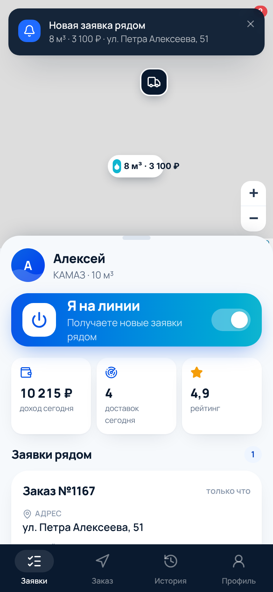
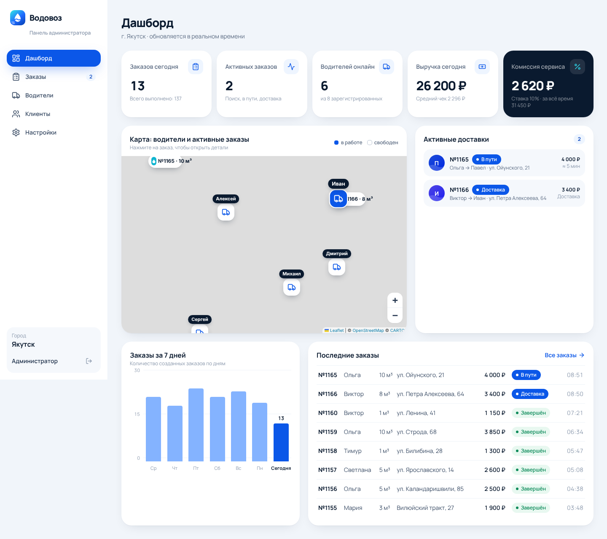

# Водовоз — демо-MVP сервиса вызова водовозов

Сервис по модели «такси с торгом», только вместо такси — водовоз. Клиент указывает адрес, объём, время и **свою цену**; ближайшие водители принимают её или предлагают свою; клиент выбирает лучшее предложение и следит за доставкой на карте.

Это рабочий интерактивный прототип: все кнопки работают, заказы создаются, статусы меняются, данные сохраняются. Есть три интерфейса (клиент, водитель, администратор) и демо-режим, в котором весь цикл можно показать без SMS, банковских карт и GPS.

| Клиент: главная | Предложения водителей | Водовоз едет | Лента водителя |
|---|---|---|---|
|  |  |  |  |



> На скриншотах серый фон вместо карты: в среде, где они снимались, не было доступа к серверам тайлов. При обычном запуске видна карта OpenStreetMap.

---

## Быстрый старт

Нужен Node.js 20+.

```bash
npm install
npm run dev          # http://localhost:3000
```

Продакшен-сборка:

```bash
npm run build
npm start
```

Внешние ключи и `.env` не нужны. Карта — Leaflet + бесплатные тайлы OpenStreetMap (подложка CARTO Voyager). Чтобы переключиться на «чистые» тайлы OSM, задайте `NEXT_PUBLIC_MAP_TILES=osm`.

## Тестовые аккаунты

| Роль          | Email            | Пароль    |
|---------------|------------------|-----------|
| Клиент        | demo@client.ru   | demo123   |
| Водитель      | demo@driver.ru   | demo123   |
| Администратор | demo@admin.ru    | demo123   |

На главной странице (`/`) у каждой роли есть кнопка входа в один клик и кнопка «открыть в новой вкладке» (`/login?demo=client|driver|admin`). Код из SMS при регистрации — **1234**.

## Как показывать демо

**Вариант 1 — только клиент (≈ 1,5 минуты).** Войдите клиентом → введите «Ленина 15» → 5 м³ → «Заказать воду» → «Далее» → «Далее» → цена 2 500 ₽ → «Найти водовоз». Через несколько секунд придут 3 предложения (например, Алексей — 2 700 ₽, Михаил — 2 500 ₽, Сергей — 2 800 ₽). Откройте карточку водителя → «Заказать этого водовоза» → водовоз поедет по карте → прибудет → сольёт воду → «Заказ завершён» → оценка.

**Вариант 2 — клиент и водитель рядом (самый наглядный).** Откройте клиента и водителя в двух вкладках. Водитель включает «Я на линии». Клиент создаёт заказ — заявка появляется в ленте водителя. Водитель нажимает «Предложить цену» (2 700 ₽, 15 мин) — предложение тут же появляется у клиента. Клиент выбирает Алексея — водитель получает «Клиент выбрал вас» и сам ведёт заказ: «Начать поездку» → «Я прибыл» → «Начать слив воды» → «Завершить доставку». Клиент видит каждый шаг.

**Вариант 3 — только водитель.** Включите «Я на линии». Через несколько секунд тестовый клиент создаст заявку рядом. Примите её или предложите цену; тестовый клиент подтвердит выбор, дальше статусы ведёт водитель.

**Администратор.** Дашборд с KPI, картой водителей и активных заказов, графиком за 7 дней. Клик по заказу открывает карточку: клиент, водитель, предложения, история статусов, экономика; статус можно сменить вручную, заказ — отменить или удалить. В разделе «Водители» — просмотр, редактирование, проверка документов, блокировка. В «Настройках» — комиссия, скорость симуляции, город, сброс данных.

> Кнопка «Демо: перейти к следующему этапу» на экране заказа сразу переводит его дальше — удобно, если время на презентацию ограничено. В «Настройках» администратора есть скорость симуляции 0.5×–4×.

## Как устроен демо-режим

- **Данные** хранятся в `localStorage` и общие для всех вкладок одного браузера. Сессия хранится отдельно для каждой вкладки (`sessionStorage`), поэтому клиент и водитель могут работать в соседних вкладках.
- **Симулятор** (`lib/store/engine.ts`) играет за тестовых участников: водители присылают предложения цены, едут по маршруту, прибывают и сливают воду; тестовые клиенты создают фоновые заявки и выбирают водителя. Симулятор работает только в одной вкладке-«лидере».
- **Живой водитель.** Пока открыта вкладка водителя, она шлёт «пульс», и его заказами управляет человек, а не симулятор. Когда вкладку закрывают, демо-водитель Алексей снова отвечает автоматически.
- **Геокодер и маршруты** — демо-реализации без платных API (`lib/geo.ts`): адрес детерминированно превращается в точку внутри города, маршрут строится «по кварталам».

## Структура проекта

```text
app/                      # маршруты Next.js (App Router)
  page.tsx                # лендинг + Demo Mode (вход в один клик)
  login/, register/       # вход, регистрация клиента/водителя, SMS-код (демо)
  client/                 # интерфейс клиента
    page.tsx              #   главная: карта + «Куда доставить воду?»
    new/                  #   мастер заказа: Адрес → Объём → Время → Цена
    order/[id]/           #   поиск → предложения → выбор → трекинг → оценка
    orders/               #   «Мои заказы» с фильтрами
    notifications/, profile/
  driver/                 # интерфейс водителя
    page.tsx              #   «Я на линии», лента заявок, предложение цены
    order/[id]/           #   активный заказ: статусы, клиент, экономика
    history/, profile/, notifications/
  admin/                  # админ-панель
    page.tsx              #   дашборд: KPI, карта, активные доставки, график
    orders/, drivers/, clients/, settings/
components/
  ui/                     # Button, Card, Modal, Field, Segmented, Toast, Stars…
  brand/                  # логотип, иллюстрация водовоза
  map/                    # MapView (Leaflet + OSM), маркеры, маршрут
  client/, driver/, admin/, shared/
data/                     # тестовые данные: города, 8 водителей, пользователи, ~150 заказов
hooks/                    # useDB, useSession, useNow, useEngine, useDriverHeartbeat
lib/
  store/
    repository.ts         # интерфейс хранилища + реализация на localStorage
    store.ts              # реактивное хранилище (useSyncExternalStore)
    actions.ts            # доменные операции (создание заказа, предложения, статусы…)
    selectors.ts          # производные данные (лента, позиция водителя, статистика)
    engine.ts             # симулятор демо-режима
  geo.ts, pricing.ts, status.ts, format.ts, auth.ts, draft.ts
types/index.ts            # доменные типы — контракт между UI и данными
supabase/schema.sql       # готовая схема PostgreSQL/Supabase под эти типы
```

## Реализованные функции

**Клиент:** регистрация (имя, телефон, email, SMS-код в демо) · главный экран с картой и вопросом «Сколько воды вам нужно и куда её доставить?» · адрес с подсказками или точкой на карте · объём 1/2/3/5/10 м³ или свой · тип воды (питьевая / техническая / для хоз. нужд) · «Как можно скорее», «Запланировать» (дата и время), «Регулярная доставка» (частота, день недели, время) · желаемая цена с рекомендацией и комментарий с быстрыми тегами · прогресс «1. Адрес → 2. Объём → 3. Время → 4. Цена → 5. Водитель» · экран поиска с радаром и водовозами рядом (расстояние, ETA, объём, рейтинг, фото) · сравнение предложений («Ваша цена / Предложение водителя», сортировка по цене, времени и рейтингу) · карточка водителя (фото, рейтинг, отзывы, опыт, автомобиль, частично скрытый госномер, расстояние, ETA, цена) · трекинг водовоза на карте с маршрутом и ETA · звонок и чат (имитация) · отмена с выбором причины · экран «Заказ завершён» и оценка со звёздами и отзывом · история с фильтрами Все / Активные / Завершённые / Отменённые · уведомления (лента и всплывающие) · профиль, регулярные доставки, смена города.

**Водитель:** регистрация с автомобилем, госномером, объёмом цистерны и фото · переключатель «Я на линии / Я не на линии» · лента заявок рядом (адрес, объём, тип, время, цена клиента, расстояние) · «Принять за X ₽» или «Предложить цену» со своей ценой, временем прибытия и расчётом дохода · подтверждение выбора клиентом · статусы «Начать поездку → Я прибыл → Начать слив воды → Завершить доставку» · отказ от заказа (заказ возвращается в поиск) · экономика заказа (стоимость, доход, комиссия) · история и заработок · профиль: фото, рейтинг, стаж, автомобиль, статус проверки, демо-карточки документов, отзывы, редактирование.

**Администратор:** дашборд (заказов сегодня, активных, водителей онлайн, выручка, комиссия сервиса) · карта водителей и активных заказов · активные доставки · график заказов за 7 дней · таблица заказов с поиском и фильтрами по статусу и периоду · карточка заказа с ручной сменой статуса, отменой и удалением · водители: просмотр, редактирование, проверка документов, блокировка · клиенты: заказы, суммы, дата регистрации, блокировка · настраиваемая комиссия (по умолчанию 10%), скорость симуляции, фоновая активность, смена города, сброс данных.

**Статусы заказа:** 1. Новый заказ → 2. Поиск водовоза → 3. Получение предложений → 4. Водитель выбран → 5. Водовоз едет к клиенту → 6. Водовоз прибыл → 7. Доставка воды → 8. Заказ завершён / 9. Отменён. Все экраны обновляются в реальном времени, в том числе между вкладками.

**Экономика:** `стоимость = доход водителя + комиссия сервиса`. Ставка фиксируется в заказе в момент выбора водителя, поэтому её изменение в админке не пересчитывает старые заказы. Пример: 2 700 ₽ → водителю 2 430 ₽, сервису 270 ₽.

**Города:** Якутск (по умолчанию), Новосибирск, Красноярск, Казань, Москва. Новый город добавляется одним объектом в `data/cities.ts`; демо-водители хранят смещение от центра и переносятся в любой город.

## Переход от MVP к реальному сервису

1. **База данных и API.** Применить `supabase/schema.sql`. Реализовать `DataRepository` (`lib/store/repository.ts`) поверх Supabase и перенести функции из `lib/store/actions.ts` в серверные RPC или Route Handlers с проверкой прав. Экраны менять не придётся: они работают через `useDB()` и доменные действия.
2. **Realtime.** Заменить `storage`-события на Supabase Realtime или WebSocket (подписки на `orders`, `offers`, `messages`, `notifications`).
3. **Авторизация.** Supabase Auth с входом по телефону и SMS-OTP (SMS.ru, SMSC, МТС Exolve), роли в `profiles.role`, RLS-политики (заготовка есть в схеме).
4. **Геолокация водителей.** Мобильное приложение водителя (React Native / Flutter) с фоновой отправкой GPS; поиск ближайших — функция `nearby_drivers` на PostGIS.
5. **Карты.** Геокодер и подсказки адресов (DaData, Яндекс Геокодер, 2ГИС или свой Nominatim), маршрутизация и ETA (OSRM / Valhalla / GraphHopper), коммерческие тайлы или свой тайл-сервер.
6. **Платежи.** Эквайринг (ЮKassa, CloudPayments, Т-Касса), холдирование суммы при выборе водителя, сплит-платежи с выплатами водителям (самозанятые / ИП), чеки по 54-ФЗ.
7. **Связь.** Подменные номера для звонков (Voximplant, Exolve), чат на сервере, push-уведомления (FCM / APNs, Web Push).
8. **Диспетчеризация.** Рассылка заявки по радиусу с расширением, тайм-ауты предложений, автоотмена, правила при отмене после выезда, штрафы и рейтинг.
9. **Верификация водителей.** Загрузка документов в хранилище (Supabase Storage / S3), проверка модератором, санитарный паспорт цистерны для питьевой воды, юридическая проверка.
10. **Регулярные доставки.** Планировщик (cron / Supabase Edge Functions), который создаёт заказы по `regular_plans`.
11. **Юридическое и операционное.** Оферта, политика обработки персональных данных (152-ФЗ), поддержка, аналитика (продуктовые метрики, воронка), мониторинг ошибок (Sentry).
12. **Удалить демо-слой:** `lib/store/engine.ts`, тестовые сиды `data/*`, демо-геокодер.

## Технологии

Next.js 16 (App Router) · React 19 · TypeScript · Tailwind CSS 4 · Lucide Icons · Leaflet + react-leaflet + OpenStreetMap. Состояние — mock-бэкенд на `localStorage` за интерфейсом репозитория.
