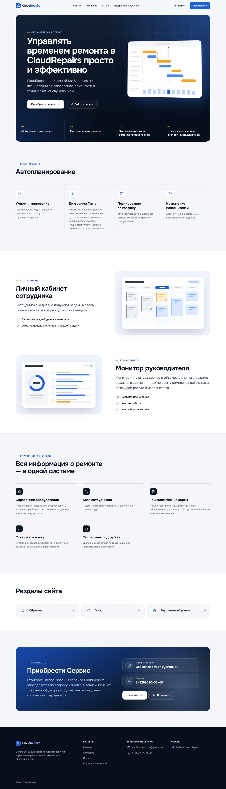
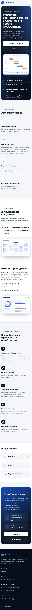
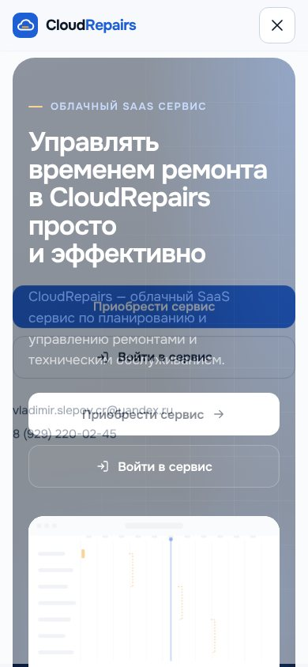

# CloudRepairs — новый сайт

Новая версия сайта [cloudrepairs.ru](https://cloudrepairs.ru/). Четыре страницы по адресам оригинала, общая дизайн-система, адаптивная вёрстка от 320 px до больших мониторов, статический пререндер для поисковиков.

| Главная | Мобильная версия | Мобильное меню |
|---|---|---|
|  |  |  |

> **Важно про содержимое.** Из среды разработки сайт cloudrepairs.ru не открывался: сетевая политика запрещала соединение. Тексты главной страницы восстановлены по фрагментам из поискового индекса. Содержимое страниц «Обучение», «О нас» и «Внутреннее обучение» получить не удалось. На этих страницах стоят видимые места «Оригинальный материал не получен». Ничего не придумано. Подробности — в [docs/AUDIT.md](docs/AUDIT.md), порядок переноса — в разделе [«Перенос оригинальных материалов»](#перенос-оригинальных-материалов).

## Быстрый старт

Нужен Node.js 20+.

```bash
cd cloudrepairs
npm install
npm run dev        # http://localhost:5173
```

Production-сборка и локальный просмотр:

```bash
npm run build      # проверка типов → сборка → пререндер в dist/
npm run preview    # http://localhost:4173
```

Другие команды:

| Команда | Что делает |
|---|---|
| `npm run typecheck` | Проверка TypeScript |
| `npm run import:original` | Скачивает тексты и изображения четырёх страниц оригинала в `import/` (запускать там, где cloudrepairs.ru открывается) |

В режиме разработки есть служебная страница **`/__ui/`**. Это витрина компонентов: оглавление, галерея с полноэкранным просмотром, списки, цитаты, файлы. В production-сборку она не попадает.

## Страницы

| URL | Страница | Источник содержимого | Статус |
|---|---|---|---|
| `/` | Главная | `src/content/home.ts` | Тексты из поискового индекса, часть формулировок нужно сверить |
| `/obuchen/` | Обучение | `src/content/obuchen.ts` | Оригинал не получен — места для материалов |
| `/about/` | О нас | `src/content/about.ts` | Оригинал не получен — места для материалов |
| `/vnutyankaya-training/` | Внутреннее обучение | `src/content/vnutyankaya-training.ts` | Оригинал не получен — места для материалов |
| любой другой | 404 | `src/pages/NotFoundPage.tsx` | — |

## Стек и архитектура

- **React 19 + TypeScript + Vite 7**, маршрутизация — **React Router 7**.
- **CSS Modules** и дизайн-токены в CSS-переменных (`src/styles/tokens.css`). UI-библиотек нет.
- Шрифт **Onest** (создан для кириллицы) подключён локально через `@fontsource-variable/onest`, без запросов к Google Fonts.
- **Пререндер.** `npm run build` собирает клиент, затем SSR-сборку и отрисовывает каждую страницу в готовый HTML: `dist/obuchen/index.html` и т. д. Поисковики получают полный текст и мета-теги без выполнения JS. В браузере React «оживляет» этот HTML (hydration).
- **Содержимое отделено от вёрстки.** Все тексты лежат в `src/content/*.ts`. Страницы «Обучение», «О нас» и «Внутреннее обучение» используют один шаблон `ContentPage`, который рисует типизированные блоки: абзац, список, цитата, изображение, галерея, видео/презентация, файл, место для материала.

```
cloudrepairs/
├── index.html                  шаблон HTML (сюда пререндер вставляет страницу и <head>)
├── public/                     favicon, apple-touch-icon, og-image
├── scripts/
│   ├── prerender.mjs           пререндер страниц, sitemap.xml, robots.txt
│   └── import-original.mjs     импорт текстов и изображений с cloudrepairs.ru
├── docs/AUDIT.md               аудит и источники
└── src/
    ├── main.tsx                клиентский вход (hydrate / render)
    ├── entry-server.tsx        вход для пререндера
    ├── App.tsx                 маршруты
    ├── seo.ts                  title, description, Open Graph, canonical
    ├── content/                ВСЕ ТЕКСТЫ САЙТА
    │   ├── site.ts             меню, контакты, ссылка входа
    │   ├── home.ts             главная
    │   ├── obuchen.ts, about.ts, vnutyankaya-training.ts
    │   └── types.ts            модель блоков содержимого
    ├── pages/                  HomePage, ContentPage (общий шаблон), NotFoundPage
    ├── components/
    │   ├── layout/             Header (+ мобильное меню), Footer, Layout, ScrollManager, SeoManager
    │   ├── ui/                 Button, Icon, Section, PageHero, ContentSlot, Gallery, Lightbox, Toc
    │   ├── content/            Blocks (рендер блоков), BuyBand («Приобрести Сервис»)
    │   ├── illustrations/      SVG-иллюстрации: диаграмма Ганта, календарь, монитор
    │   └── brand/              Logo (временный)
    ├── styles/                 tokens.css, global.css
    └── dev/UiKitPage.tsx       витрина компонентов (только dev)
```

## Дизайн: что изменено

Дизайн-система:
- **Палитра.** «Облачный» синий `#1F5FD6` как основной цвет. Глубокий тёмно-синий `#0B1626` для текста и тёмных секций. Янтарный `#F5A524` как точечный акцент — цвет критического пути на диаграмме Ганта. Оригинальный логотип получить не удалось, поэтому цвета вынесены в токены и меняются в одном файле.
- **Типографика.** Onest, адаптивные размеры через `clamp()`. Заголовки с плотным трекингом. Основной текст 17 px, межстрочный интервал 1,62, ширина колонки до 68 знаков. Переносы и `text-wrap: balance` для длинных русских заголовков.
- **Форма.** Единые радиусы (8/12/20/28 px). Тени только у «окон» иллюстраций. Секции разделены линейками, а не карточками.

Компоненты:
- **Шапка.** Закрепляется при прокрутке, полупрозрачный фон с размытием. Подсвечен активный пункт меню. Кнопки «Войти» и «Приобрести».
- **Мобильное меню.** Полноэкранная панель с крупными пунктами, кнопками и контактами. Закрывается по Esc, при переходе и при расширении окна. Прокрутка страницы под меню блокируется.
- **Главная.** Тёмный первый экран со схемой диаграммы Ганта. Полоса «В основе сервиса» из четырёх пунктов. Функции автопланирования. Разделы «Личный кабинет сотрудника» и «Монитор руководителя» с иллюстрациями. Справочники и отчёты. Ссылки на разделы. Финальный блок со стоимостью и контактами.
- **Внутренние страницы.** Первый экран с хлебными крошками. Оглавление с подсветкой текущего раздела: колонка на десктопе, раскрывающийся список на мобильных. Галерея с полноэкранным просмотром.
- **Иллюстрации.** Векторные схемы без подписей и цифр. Это графика, а не данные о сервисе.

## Проверка

Проверено в Chromium (Playwright) на production-сборке:
- ширина 1440, 1024, 768 и 390 px — все 4 страницы и 404: нет горизонтальной прокрутки, ровно один `<h1>`, нет ошибок в консоли;
- переходы по меню (десктоп и мобильное), «Приобрести» → блок `#buy`, прокрутка наверх при смене страницы, обновление `title` и `canonical`;
- мобильное меню: открытие, `aria-expanded`, Esc, закрытие после перехода;
- галерея (`/__ui/`): открытие нужного изображения, стрелки на клавиатуре и кнопки, переход по кругу, Esc, снятие блокировки прокрутки;
- ссылка «Перейти к содержимому» — первый элемент при навигации с клавиатуры;
- axe-core (WCAG 2 A/AA и best-practice) — 0 нарушений на всех страницах при 1440 и 390 px.

## Перенос оригинальных материалов

1. На компьютере, где открывается cloudrepairs.ru, выполните `npm run import:original`. В `import/<страница>/` появятся `page.html`, `content.md` (title, description и текст по порядку) и папка `images/`. Другой вариант — разрешить домен `cloudrepairs.ru` в настройках сети облачной среды (Network access → Allowed domains) и попросить Claude перенести материалы.
2. Изображения положите в `public/media/<страница>/`. Лучше в WebP, шириной до 1600–2000 px.
3. В `src/content/<страница>.ts` замените блоки `{ type: 'slot', … }` на реальные:

   ```ts
   sections: [
     {
       id: 'programmy',
       title: 'Название раздела с оригинальной страницы',
       blocks: [
         { type: 'paragraph', text: '…' },
         { type: 'list', items: ['…', '…'] },
         { type: 'gallery', items: [{ src: '/media/vnutyankaya-training/slide-1.webp', alt: '…', width: 1600, height: 900 }] },
         { type: 'embed', src: 'https://…', title: 'Видео: …' },
         { type: 'file', href: '/media/vnutyankaya-training/presentation.pdf', label: 'Презентация', meta: 'PDF, 4 МБ' },
       ],
     },
   ]
   ```
4. Сверьте формулировки главной в `src/content/home.ts` (в комментариях помечено «дословно» или «пересказ»).
5. Замените временный логотип: `src/components/brand/Logo.tsx`, `public/favicon.svg`, `public/apple-touch-icon.png`, `public/og-image.jpg`.
6. Впишите оригинальные `title` и `description` в `src/seo.ts`.

## Не получено с оригинального сайта

- Полное содержимое страниц `/obuchen/`, `/about/` и `/vnutyankaya-training/`: тексты, изображения, медиа, формы.
- Изображения, фотографии и логотип главной страницы.
- Точные заголовки и порядок блоков главной. Пункты меню и подвал.
- Оригинальные `title` и `description` всех страниц, кроме `title` главной («Cloud Repairs»).
- Есть ли на сайте форма заявки и какие у неё поля.

## Внешние сервисы и серверная часть

- **Форм отправки на сайте нет.** На оригинале подтверждены только контакты «Приобрести Сервис», поэтому связь идёт через ссылки `mailto:` и `tel:`. Если на оригинале есть форма заявки, для неё нужен обработчик: свой API, почтовый сервис или CRM. Без него форма работать не будет, поэтому имитацию отправки я не делал.
- **«Войти»** ведёт на веб-приложение сервиса: `https://cloudrepairs.ru/Account/Login`. Адрес задаётся в `src/content/site.ts`.

## Размещение на хостинге

После `npm run build` папка `dist/` — полностью статический сайт. Сервер не нужен.

```
dist/
├── index.html
├── obuchen/index.html
├── about/index.html
├── vnutyankaya-training/index.html
├── 404.html
├── assets/…            JS, CSS, шрифты с хешами в именах
├── sitemap.xml, robots.txt, favicon.svg, og-image.jpg, apple-touch-icon.png
```

- **Любой статический хостинг** (Netlify, Vercel, Cloudflare Pages, GitHub Pages, Яндекс Object Storage, S3): опубликуйте папку `dist/`. Команда сборки — `npm run build`, каталог — `dist`. Страница 404 подхватывается автоматически.
- **Nginx:**

  ```nginx
  server {
    server_name cloudrepairs.ru;
    root /var/www/cloudrepairs/dist;

    location / {
      try_files $uri $uri/ =404;
    }
    error_page 404 /404.html;

    location /assets/ {
      expires 1y;
      add_header Cache-Control "public, immutable";
    }
  }
  ```

- **Совместно с приложением на том же домене.** Если `cloudrepairs.ru/Account/…` и другие адреса веб-приложения должны работать дальше, проксируйте их на приложение, а остальное отдавайте из `dist/`.
- Если сайт будет жить не на `https://cloudrepairs.ru`, поменяйте `site.url` в `src/content/site.ts`: от него строятся canonical, Open Graph и sitemap.
